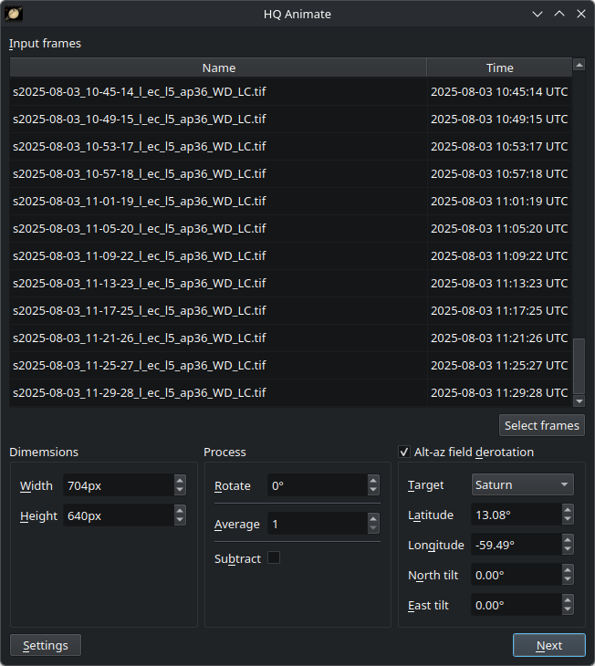

# HQ Animate
<p align="center">
    
</p>

<p align="center">Create high quality planetary timelapses</p>

<p align="center">
    
</p>

## Installation

`uv` is recommended since it installs Python applications into isolated environments.

Installation instructions for `uv`: [https://docs.astral.sh/uv/getting-started/installation/](https://docs.astral.sh/uv/getting-started/installation/)

Open a terminal and install HQ Animate with this command:

```
uv tool install https://github.com/EthanChappel/HQ-Animate.git
```

#### Upgrade

To upgrade the program to the latest version, run:

```
uv tool upgrade hq-animate
```

## Usage

To start the program, call it from a terminal:

```
hq-animate
```
